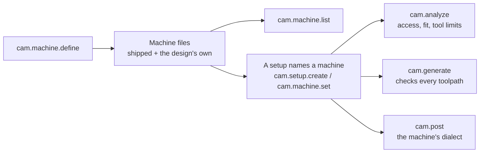

# Machine files

Every CAM job is judged against a machine. The machine decides:
- which directions a setup can cut from;
- whether the part fits;
- which tools it can hold;
- how fast those tools can turn and move;
- what the program looks like.

SolidCraft keeps what it knows about each machine in a **machine file**: a JSON document a
person or an AI assistant can read, check and write. No code changes are needed to add a
machine.

The files SolidCraft ships are in `crates/cam/machines/`. A design can bring its own files with
`cam.machine.define`. `cam.machine.list` lists every machine either way, with all its numbers
and documentation.

## Where machine files are used



## The format

```json
{
  "format": "solidcraft-machine/1",
  "id": "carvera",
  "aliases": ["makera_carvera"],
  "summary": "Makera Carvera desktop CNC mill: 360 × 240 × 140 mm, …",
  "machine": { "name": "Makera Carvera", "work_area": [360, 240, 140], "…": "…" },
  "options": [
    { "id": "carvera_4axis", "aliases": ["carvera_4th_axis"], "summary": "With Makera's 4th-axis module …",
      "machine": { "name": "Makera Carvera + 4th axis", "kinematics": { "kind": "four_axis", "rotary": { "…": "…" } },
                   "rotary_capacity": [92, 240] } }
  ],
  "kit": "makera_essential",
  "sources": [
    { "fields": ["work_area", "spindle_rpm_max", "…"], "from": "Makera's published specifications for the Carvera …", "checked": null }
  ],
  "notes": ["The control measures each tool's length after a change, so programs carry no tool length offset."]
}
```

| Field | What it holds |
|---|---|
| `format` | Always `solidcraft-machine/1`. |
| `id` | The name a setup uses: 1 to 64 lower-case letters, digits and `_`. |
| `aliases` | Other names for the same machine. Case, spaces and `-` don't matter when a setup names one. |
| `summary` | One sentence on what the machine is. |
| `machine` | The machine's numbers (below). A field left out takes its default. |
| `options` | What the machine can be fitted with. Each option is a machine of its own: the base machine with the fields under its `machine` changed. |
| `kit` | The tool kit that suits the machine (`cam.tool.kit`). |
| `sources` | Where the numbers came from: which `fields`, `from` what document, and the date they were last `checked` against it (`null`: not yet). |
| `notes` | What a programmer should know about the machine, one point each. |

### The machine's numbers

Lengths are in millimetres, speeds in rev/min or mm/min, and power in watts. A zero means
"not set", and nothing is checked against it.

| Field | Meaning |
|---|---|
| `name`, `vendor`, `model` | What it is called. |
| `post` | The post dialect `cam.post` writes for it (`makera`, …; `cam.post.list`). |
| `kinematics` | `{kind: three_axis}`, `{kind: four_axis, rotary}` or `{kind: five_axis, primary, secondary}`. A rotary axis gives its `name` (A, B or C), its `direction`, its `pivot`, its `min_deg` and `max_deg` limits, and whether it is `on_table`. |
| `work_area` | The travel in X, Y and Z. |
| `travel_min`, `travel_max` | The travel in machine coordinates, when known. |
| `gantry_clearance` | The height under the gantry: a tool and the stock together must fit. |
| `spindle_rpm_min`, `spindle_rpm_max`, `spindle_power_w` | The spindle. |
| `max_feed`, `rapid_feed`, `rotary_rapid_deg_min` | How fast it moves. |
| `tool_changer` | `{kind: automatic, slots}`, `{kind: manual}` or `{kind: unknown}`. |
| `collets` | The shank sizes its collets take. |
| `rotary_capacity` | The largest stock a rotary module takes: `[diameter, length]`. |
| `laser` | `{power_w, wavelength_nm, builtin, spot_mm}` when it has a laser. |
| `tcp`, `linearisation_tolerance`, `max_rotary_step_deg` | How the control moves rotary axes. |

## Checks

A machine file is read as untrusted input. It is refused, with the reason, when any of these
holds:
- its format tag is not `solidcraft-machine/1`;
- an id is malformed or given twice;
- a field is unknown;
- a number is not finite, is negative, or is beyond a sane maximum (100 m, 200 000 rev/min);
- the spindle range is upside down;
- a collet size is not positive;
- a tool changer has no slots;
- an option's `machine` is not an object;
- the file is larger than 256 KB;
- a list has more than 32 entries.

A file with no `sources` is accepted with a `no_sources` warning, so its numbers can be checked
later.

## Adding a machine

1. Write the file from the maker's published specification. Put every number you took from it
   in `sources`, with the date you checked it.
2. Try it in a design with
   `cam.machine.define {machine_file: {…}}`, then `cam.setup.create {machine: "<id>"}`.
   The design keeps the file. A file whose id matches a shipped machine replaces that machine in
   this design only.
3. To ship it, add the file to `crates/cam/machines/` and to the `BUILTIN` list in
   `crates/cam/src/catalog.rs`. The tests read every shipped file.

## The machines SolidCraft ships

| File | Machines |
|---|---|
| `generic-3-axis-mill.json` | `three_axis`, `four_axis_a`: limits not set |
| `generic-5-axis-trunnion-ac.json` | `trunnion_ac` |
| `generic-5-axis-trunnion-bc.json` | `trunnion_bc` |
| `generic-5-axis-head-head-bc.json` | `head_head_bc` |
| `makera-carvera.json` | `carvera`, `carvera_4axis` |
| `makera-carvera-air.json` | `carvera_air`, `carvera_air_4axis` |
| `makera-z1.json` | `z1`, `z1_4axis` |

The Makera numbers come from Makera's published specifications and the Carvera community
documentation. Their `checked` dates are empty until they are checked against those pages
again.
